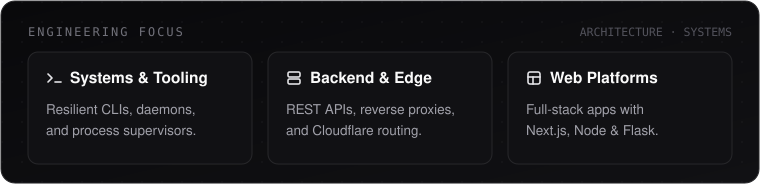
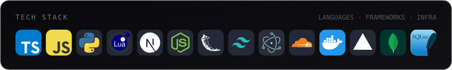
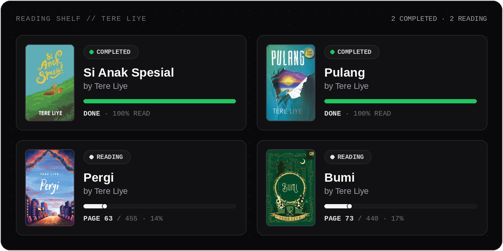
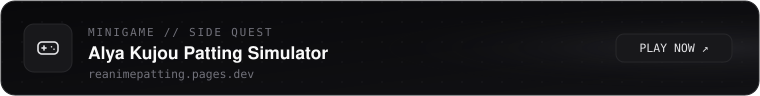
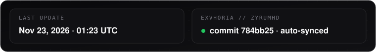

  <picture>
    <source media="(prefers-color-scheme: dark)" srcset="./assets/banner-dark.svg" />
    <source media="(prefers-color-scheme: light)" srcset="./assets/banner-light.svg" />
    
  </picture>

  <a href="https://github.com/exvhoria"><picture><source media="(prefers-color-scheme: dark)" srcset="./assets/social-github-dark.svg" /><source media="(prefers-color-scheme: light)" srcset="./assets/social-github-light.svg" /></picture></a>
  <a href="https://youtube.com/@ghosttedwastaken"><picture><source media="(prefers-color-scheme: dark)" srcset="./assets/social-youtube-dark.svg" /><source media="(prefers-color-scheme: light)" srcset="./assets/social-youtube-light.svg" /></picture></a>
  <a href="https://instagram.com/ghosttedcodm"><picture><source media="(prefers-color-scheme: dark)" srcset="./assets/social-instagram-dark.svg" /><source media="(prefers-color-scheme: light)" srcset="./assets/social-instagram-light.svg" /></picture></a>

### About

Independent software engineer based in Indonesia, currently focused on **ZyruMHD**, building backend infrastructure, self-hosted AI tooling, and full-stack web systems. I focus on resilient CLI workflows, reverse-proxy gateways, and pragmatic architectures designed to run reliably in constrained environments.

  <picture>
    <source media="(prefers-color-scheme: dark)" srcset="./assets/focus-dark.svg" />
    <source media="(prefers-color-scheme: light)" srcset="./assets/focus-light.svg" />
    
  </picture>

### Tech Stack

Core languages, runtimes, and infrastructure I build with daily:

  <picture>
    <source media="(prefers-color-scheme: dark)" srcset="./assets/techstack-dark.svg" />
    <source media="(prefers-color-scheme: light)" srcset="./assets/techstack-light.svg" />
    
  </picture>

### Current Initiative

  <picture>
    <source media="(prefers-color-scheme: dark)" srcset="./assets/requiem-dark.svg" />
    <source media="(prefers-color-scheme: light)" srcset="./assets/requiem-light.svg" />
    
  </picture>

### Featured Project

Live repository telemetry synced automatically via GitHub Actions:

  <a href="https://github.com/exvhoria/Asanagi-Code"><picture><source media="(prefers-color-scheme: dark)" srcset="./assets/featured-dark.svg" /><source media="(prefers-color-scheme: light)" srcset="./assets/featured-light.svg" /></picture></a>

### Real-Time Activity

  <picture>
    <source media="(prefers-color-scheme: dark)" srcset="./assets/streak-dark.svg" />
    <source media="(prefers-color-scheme: light)" srcset="./assets/streak-light.svg" />
    
  </picture>

  <picture>
    <source media="(prefers-color-scheme: dark)" srcset="https://github-readme-activity-graph.vercel.app/graph?username=exvhoria&amp;bg_color=09090b&amp;color=a1a1aa&amp;line=e4e4e7&amp;point=fafafa&amp;area=true&amp;area_color=27272a&amp;hide_border=false&amp;border_color=27272a&amp;radius=14&amp;custom_title=Contribution%20Activity" />
    <source media="(prefers-color-scheme: light)" srcset="https://github-readme-activity-graph.vercel.app/graph?username=exvhoria&amp;bg_color=ffffff&amp;color=52525b&amp;line=18181b&amp;point=09090b&amp;area=true&amp;area_color=e4e4e7&amp;hide_border=false&amp;border_color=e4e4e7&amp;radius=14&amp;custom_title=Contribution%20Activity" />
    
  </picture>

  <picture>
    <source media="(prefers-color-scheme: dark)" srcset="./assets/shark-dark.svg" />
    <source media="(prefers-color-scheme: light)" srcset="./assets/shark-light.svg" />
    
  </picture>

### Reading Shelf

Novels I've finished and the ones I'm currently working through in my downtime:

  <picture>
    <source media="(prefers-color-scheme: dark)" srcset="./assets/reading-dark.png" />
    <source media="(prefers-color-scheme: light)" srcset="./assets/reading-light.png" />
    
  </picture>

### Bored?

  <a href="https://reanimepatting.pages.dev/"><picture><source media="(prefers-color-scheme: dark)" srcset="./assets/minigame-dark.svg" /><source media="(prefers-color-scheme: light)" srcset="./assets/minigame-light.svg" /></picture></a>

  <picture>
    <source media="(prefers-color-scheme: dark)" srcset="./assets/footer-dark.svg" />
    <source media="(prefers-color-scheme: light)" srcset="./assets/footer-light.svg" />
    
  </picture>

  <picture>
    <source media="(prefers-color-scheme: dark)" srcset="https://img.shields.io/github/last-commit/exvhoria/exvhoria?style=for-the-badge&amp;label=LAST%20UPDATE&amp;color=27272a&amp;labelColor=111114" />
    <source media="(prefers-color-scheme: light)" srcset="https://img.shields.io/github/last-commit/exvhoria/exvhoria?style=for-the-badge&amp;label=LAST%20UPDATE&amp;color=18181b&amp;labelColor=e4e4e7" />
    
  </picture>
  <picture>
    <source media="(prefers-color-scheme: dark)" srcset="https://hits.sh/github.com/exvhoria.svg?view=today-total&amp;style=for-the-badge&amp;label=VIEWS&amp;color=27272a&amp;labelColor=111114" />
    <source media="(prefers-color-scheme: light)" srcset="https://hits.sh/github.com/exvhoria.svg?view=today-total&amp;style=for-the-badge&amp;label=VIEWS&amp;color=18181b&amp;labelColor=e4e4e7" />
    
  </picture>

