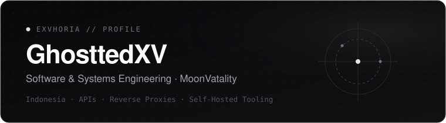
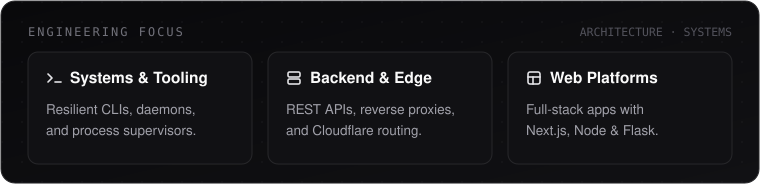
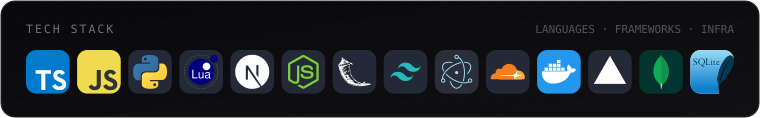
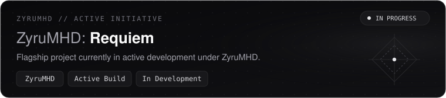
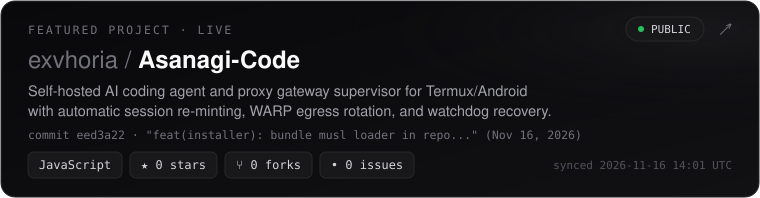
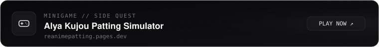
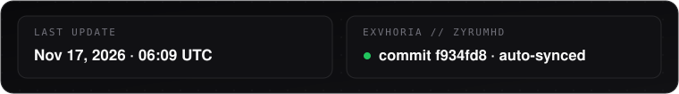

  

  
  
  

### About

Independent software engineer based in Indonesia, currently focused on **ZyruMHD**, building backend infrastructure, self-hosted AI tooling, and full-stack web systems. I focus on resilient CLI workflows, reverse-proxy gateways, and pragmatic architectures designed to run reliably in constrained environments.

  

### Tech Stack

Core languages, runtimes, and infrastructure I build with daily:

  

### Current Initiative

  

### Featured Project

Live repository telemetry synced automatically via GitHub Actions:

  

### Real-Time Activity

  

  

### Reading Shelf

Novels I've finished and the ones I'm currently working through in my downtime:

  

### Bored?

  

  

  
  

